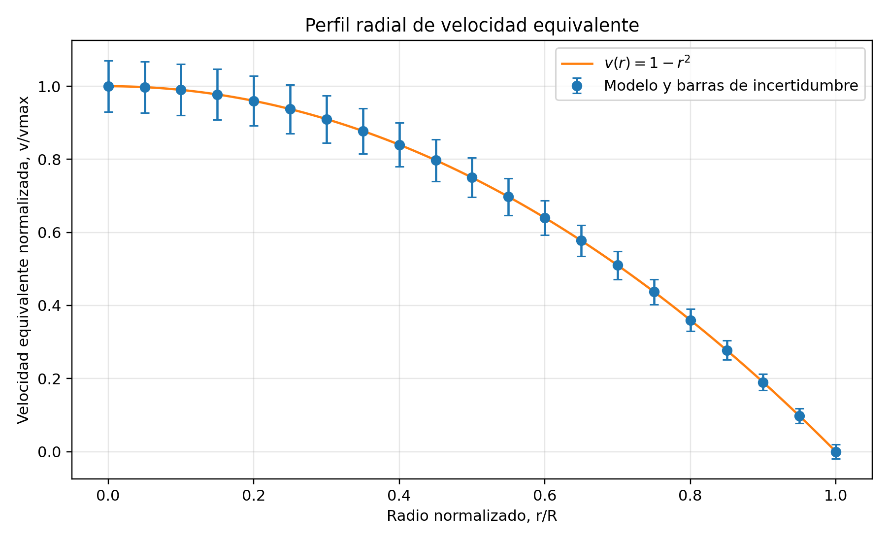
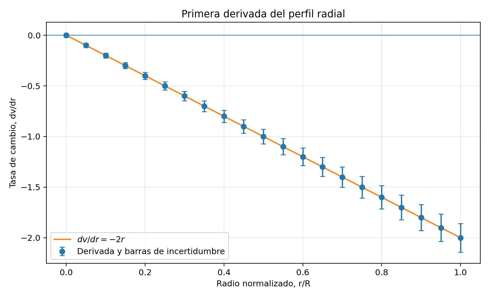
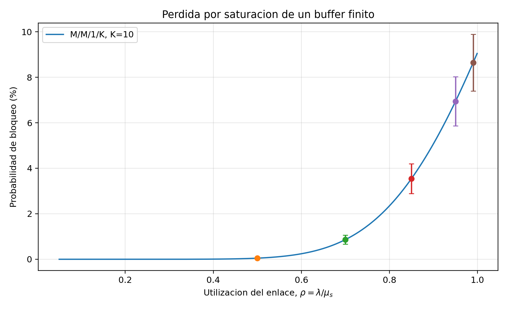
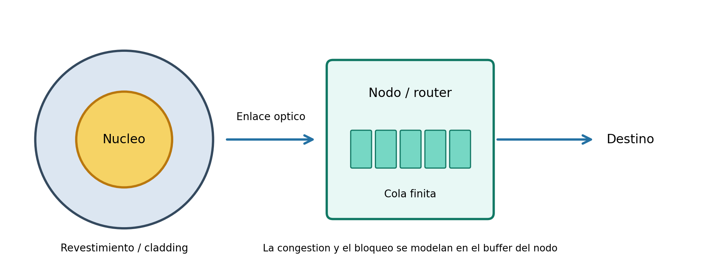

# Proyecto Final de Cálculo Diferencial – Tema 7

**Tema:** Tasa de transferencia en canales de fibra con congestión  
**Universidad:** Universidad de La Salle  
**Asignatura:** Cálculo Diferencial  
**Profesor:** Fernando Vergara  
**Integrantes:** Juan Sebastian Rozo Culma - Oscar Castañeda Ocampo

## 1. Descripción

Este proyecto presenta una simulación educativa de dos modelos matemáticos complementarios: (1) un perfil radial de velocidad equivalente obtenido al integrar la ecuación diferencial de la guía y (2) una cola finita M/M/1/K para estudiar el bloqueo de paquetes cuando el búfer de un nodo de red se llena. Se aplican integración, primera y segunda derivada, tasas de cambio, análisis de sensibilidad y propagación de incertidumbres.

**Alcance y limitaciones:** el perfil radial tiene la forma matemática de un flujo tipo Poiseuille y se utiliza como analogía para el análisis diferencial. No representa directamente la propagación de luz en una fibra óptica ni calcula por sí solo la pérdida de paquetes. La congestión se analiza aparte con el modelo M/M/1/K. Los parámetros son ilustrativos y no son mediciones de una red real.

## 2. Archivos del repositorio

- `index.html`: simulación interactiva en el navegador, con controles para modificar los parámetros y gráficas del perfil radial, su primera derivada y la probabilidad de bloqueo. Usa Chart.js desde una CDN; se requiere conexión a internet para cargar esa biblioteca.
- `modelo_tema7.py`: script de Python que calcula los modelos, deriva las funciones, propaga incertidumbres y genera las tablas y gráficas.
- `perfil_radial.csv`: datos del radio, velocidad equivalente, incertidumbre, primera derivada y segunda derivada.
- `resultados_cola.csv`: tasas de llegada, utilización, probabilidad de bloqueo, derivadas e incertidumbres.
- `requirements.txt`: bibliotecas necesarias para Python.
- `figuras/`: imágenes generadas por el script, incluidas las gráficas con barras de incertidumbre.

## 3. Modelos matemáticos

### 3.1. Perfil radial equivalente

La ecuación de la guía es:

\[
\frac{dv}{dr}=\frac{r}{2\mu}\frac{dP}{dz}.
\]

Se define \(G=-dP/dz>0\). Al integrar y aplicar la condición de frontera \(v(R)=0\), se obtiene:

\[
v(r)=\frac{G}{4\mu}(R^2-r^2),\quad
\frac{dv}{dr}=-\frac{Gr}{2\mu},\quad
\frac{d^2v}{dr^2}=-\frac{G}{2\mu}.
\]

Para el caso adimensional del programa se usan \(G=4\), \(\mu=1\) y \(R=1\). Así, \(v(r)=1-r^2\), \(dv/dr=-2r\) y \(d^2v/dr^2=-2\). La velocidad equivalente es máxima en el centro \(r=0\) y vale cero en la pared \(r=R\).

### 3.2. Congestión: cola M/M/1/K

La utilización es \(\rho=\lambda/\mu_s\), donde \(\lambda\) es la tasa de llegada y \(\mu_s\) la tasa de servicio. Para capacidad total \(K\), la probabilidad de bloqueo es:

\[
P_K=\frac{\rho^K}{\sum_{j=0}^{K}\rho^j}\quad (\rho\ne1),
\qquad P_K=\frac{1}{K+1}\quad (\rho=1).
\]

La simulación usa \(K=10\), \(\mu_s=1000\) paquetes/s y tasas de llegada de 500, 700, 850, 950 y 990 paquetes/s. Estos valores son supuestos didácticos.

## 4. Instalación y reproducción

Requisitos: Python 3.10 o posterior, NumPy y Matplotlib.

Instalar dependencias:

```bash
python -m pip install -r requirements.txt
```

Ejecutar desde la carpeta del repositorio:

```bash
python modelo_tema7.py
```

El programa genera o actualiza `perfil_radial.csv`, `resultados_cola.csv` y las imágenes de `figuras/`. Las barras de error representan incertidumbres asumidas para la simulación, no mediciones experimentales. Para usar la simulación web, abrir `index.html` en un navegador con conexión a internet.

## 5. Resultados de referencia

Con los parámetros predeterminados, el perfil radial normalizado es \(v(r)=1-r^2\), su primera derivada es \(-2r\) y su segunda derivada es \(-2\). En la cola M/M/1/K, la probabilidad de bloqueo calculada es aproximadamente 0.0489 % para \(\rho=0.50\) y 8.6410 % para \(\rho=0.99\). Los valores dependen de los parámetros establecidos en el código.

## 6. Gráficas generadas

Las siguientes figuras son generadas por `modelo_tema7.py` y se guardan en `figuras/`:









## 7. Referencias

- International Telecommunication Union. (2024). *Recommendation ITU-T G.652: Characteristics of a single-mode optical fibre and cable*. https://www.itu.int/rec/T-REC-G.652-202408-I
- Agrawal, G. P. (2021). *Fiber-Optic Communication Systems* (5th ed.). Wiley. https://doi.org/10.1002/9781119737391
- Allman, M., Paxson, V., & Blanton, E. (2009). *TCP Congestion Control* (RFC 5681). RFC Editor. https://www.rfc-editor.org/rfc/rfc5681.html
- Shortle, J. F., Thompson, J. M., Gross, D., & Harris, C. M. (2018). *Fundamentals of Queueing Theory* (5th ed.). Wiley. https://doi.org/10.1002/9781119453765
- Tong, D. (s. f.). *Fluid Mechanics: Lectures on Theoretical Physics*. University of Cambridge. https://davidtong.org/teaching/fluid-mechanics/

**Repositorio:** https://github.com/oscarcastaocampo-create/proyectofinalcalculo

